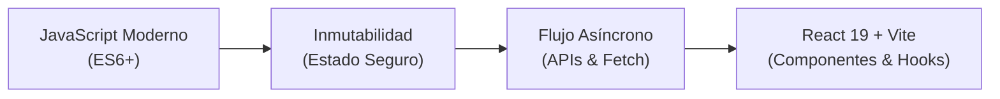

# 🏛️ Plataforma de Formación Técnica ADSO · Ficha 3314621

> **Servicio Nacional de Aprendizaje (SENA)**  
> **Regional Huila** · Centro Agroempresarial y Desarrollo Pecuario del Huila (CADPH - Garzón)  
> **Programa:** Tecnólogo en Análisis y Desarrollo de Software (ADSO)  
> **Ficha:** 3314621  
> **Instructor Técnico:** Ing. Hector David Toledo Garcia ([hdtoledo.dev](https://www.hdtoledo.dev/))  
> **Competencia:** `DESARROLLAR LA SOLUCIÓN DE SOFTWARE DE ACUERDO CON EL DISEÑO Y METODOLOGÍAS DE DESARROLLO` (Código: 220501096)  
> **Fase del Proyecto:** Fase de Ejecución · Desarrollo de Interfaces y Lógica Frontend  

---

## 🎯 1. Propósito Pedagógico del Repositorio

Este repositorio contiene el material de aprendizaje, laboratorios prácticos, retos de código y recursos estructurados para los aprendices de la **Ficha ADSO 3314621**. 

La plataforma web interactiva implementa con rigurosidad la experiencia visual y funcional (**UI/UX**) del sistema institucional **SI Contratista SENA** (diseño responsivo con **HTML5**, **Tailwind CSS** y **JavaScript Vanilla**), integrando:

- **Tablero Principal (Dashboard):** Vista panorámica de módulos con indicadores de avance y atajos directos.
- **Checklist de Alistamiento Interactivo:** Verificación de los 8 prerrequisitos esenciales para desarrollar en **React 19 + Vite**, con guardado automático en el navegador (`localStorage`).
- **Laboratorio Live Code (Playground):** Editor de código en caliente con presets pedagógicos y consola virtual de salida para demostración en video-beam y práctica en aula.
- **Buddy el Chatbot Tutor:** Asistente interactivo guiado para resolver inquietudes técnicas sobre sintaxis moderna, inmutabilidad y promesas.
- **Planilla de Evidencias:** Matriz de actividades de aprendizaje (AA) y rúbricas conforme a la competencia del programa.

---

## 🗺️ 2. Ruta de Formación Hacia React + Vite

Para construir aplicaciones cliente robustas y escalables con **React + Vite**, es indispensable dominar con anterioridad los tres pilares de JavaScript moderno:



| Módulo | Denominación | Propósito Clave | Enlace a la Guía |
|---|---|---|---|
| **01** | **JavaScript ES6+** | `const`/`let`, Arrow Functions, Destructuring y Spread/Rest | [`modulos/01-javascript-moderno-es6/`](./modulos/01-javascript-moderno-es6/README.md) |
| **02** | **Inmutabilidad** | `.map()`, `.filter()`, `.reduce()`, actualización sin mutar memoria | [`modulos/02-inmutabilidad/`](./modulos/02-inmutabilidad/README.md) |
| **03** | **Flujo Asíncrono** | Promesas, `async`/`await`, `try...catch` y consumo de APIs con `fetch()` | [`modulos/03-flujo-asincrono/`](./modulos/03-flujo-asincrono/README.md) |
| **04** | **Camino a React + Vite** | Componentes funcionales, JSX, Props, Estado (`useState`) y ciclo de vida | [`modulos/04-camino-a-react-vite/`](./modulos/04-camino-a-react-vite/README.md) |

---

## ⏱️ 3. Metodología de Aula en 3 Bloques

La dinámica pedagógica implementada por el instructor en cada sesión presencial se divide en:

1. **Bloque 1 · Teoría y Live Coding (~110 min):**
   - Explicación conceptual en el tablero interactivo.
   - Demostración de código línea a línea sin copiar ni depender de IA de manera pasiva.
2. **Bloque 2 · Taller Práctico Asistido (~70 min):**
   - Resolución de casos de negocio en el IDE (VS Code) de manera individual o por parejas.
3. **Bloque 3 · Sustentación en Caliente y Git (~40 min):**
   - Modificación de código en vivo puesto por puesto y registro de avances en repositorios personales de GitHub.

---

## 🚀 4. Cómo Utilizar este Repositorio

### A. Abrir la Plataforma Web Interactiva
No requiere instalación de servidores pesados. Solo clona y abre en tu navegador:
```bash
# 1. Clonar el repositorio
git clone https://github.com/tu-usuario/repo3314621.git

# 2. Entrar a la carpeta
cd repo3314621

# 3. Abrir index.html en el navegador preferido (o con Live Server en VS Code)
# En Windows:
start index.html
```

### B. Probar los Ejercicios de Consola con Node.js
Cada módulo cuenta con un archivo ejecutable en consola para experimentar con Node.js:
```bash
# Probar ejercicios de ES6+
node modulos/01-javascript-moderno-es6/ejercicios.js

# Probar ejercicios de Inmutabilidad
node modulos/02-inmutabilidad/ejercicios.js

# Probar ejercicios Asíncronos
node modulos/03-flujo-asincrono/ejercicios.js
```

---

## 📂 5. Estructura de Carpetas

```text
repo3314621/
├── index.html                           # Aplicación Web Interactiva (UI SI Contratista SENA)
├── README.md                            # Guía y documentación oficial de la competencia
├── .gitignore                           # Exclusiones de control de versiones
├── .github/
│   └── workflows/
│       └── deploy.yml                   # Despliegue automático a GitHub Pages
└── modulos/
    ├── 01-javascript-moderno-es6/
    │   ├── README.md                    # Fundamentos teóricos ES6+
    │   ├── ejercicios.js                # Prácticas ejecutables en Node.js / Browser
    │   └── taller-practico.md           # Reto de aula evaluable
    ├── 02-inmutabilidad/
    │   ├── README.md                    # Filosofía de inmutabilidad para React
    │   ├── ejercicios.js                # Métodos seguros vs métodos mutables
    │   └── taller-practico.md           # Reto de transformación de datos e-commerce
    ├── 03-flujo-asincrono/
    │   ├── README.md                    # Event loop, Promises y Fetch API
    │   ├── ejercicios.js                # Consumo de servicios REST con async/await
    │   └── taller-practico.md           # Reto de integración con APIs externas
    └── 04-camino-a-react-vite/
        ├── README.md                    # Conexión directa: JS -> React
        └── guia-instalacion-vite.md     # Creación de proyecto base con Vite
```

---

## 👨‍🏫 Autor y Créditos

- **Instructor Técnico:** Ing. Hector David Toledo Garcia
- **Institución:** Servicio Nacional de Aprendizaje (SENA) - CADPH Garzón, Regional Huila
- **Referencia Histórica:** [formacionadso](https://github.com/hdtoledo/formacionadso)
- **Licencia:** Material educativo de libre distribución para aprendices y centros de formación SENA.
