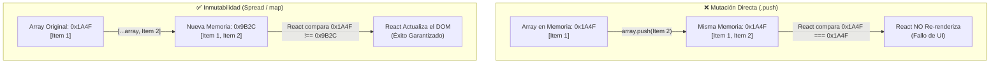

# Módulo 02: Inmutabilidad en JavaScript

> **Programa:** Tecnólogo en Análisis y Desarrollo de Software (ADSO)  
> **Ficha:** 3314621  
> **Competencia:** Desarrollar la solución de software de acuerdo con el diseño y metodologías de desarrollo.

---

## 🎯 Por qué la Inmutabilidad es la Regla #1 en React

En el desarrollo de software frontend moderno (y muy especialmente en React), **los datos del estado jamás se modifican directamente**.

### ¿Qué ocurre internamente en React?
React utiliza un mecanismo de comparación superficial por referencia llamado `Object.is`.
- Si mutas un arreglo con `arreglo.push(nuevoItem)`, **la dirección de memoria sigue siendo la misma**.
- React observa la misma dirección de memoria, asume que nada ha cambiado y **no re-renderiza la pantalla**. El usuario ve datos desactualizados y se generan *bugs* difíciles de depurar.
- Cuando creas un nuevo arreglo con `[...arreglo, nuevoItem]`, React detecta una **nueva referencia en memoria** y actualiza el Virtual DOM de manera eficiente.



---

## 📌 1. Métodos de Arreglos: Prohibidos vs Recomendados

| Operación | ❌ Método Mutable (PROHIBIDO en React) | ✅ Método Inmutable (OBLIGATORIO en React) |
|---|---|---|
| **Agregar al final** | `array.push(item)` | `[...array, item]` |
| **Agregar al inicio** | `array.unshift(item)` | `[item, ...array]` |
| **Eliminar por ID o índice** | `array.splice(index, 1)` | `array.filter(item => item.id !== id)` |
| **Modificar un elemento** | `array[index].precio = 50` | `array.map(i => i.id === id ? {...i, precio: 50} : i)` |
| **Ordenar elementos** | `array.sort()` | `[...array].sort((a, b) => ...)` |
| **Invertir orden** | `array.reverse()` | `[...array].reverse()` |

---

## 📌 2. Los Tres Métodos Estrella: `map`, `filter` y `reduce`

### A. `.map()` · Transformación 1 a 1 (Indispensable para JSX)
Genera un **nuevo arreglo** de la misma longitud aplicando una función transformadora a cada elemento.

```javascript
const productos = [
  { id: 1, nombre: "Teclado Mecánico", precio: 120000 },
  { id: 2, nombre: "Mouse Óptico", precio: 60000 }
];

// En React: Renderizar lista de productos a JSX
const vistaProductos = productos.map(p => (
  <div key={p.id} className="tarjeta-producto">
    <h3>{p.nombre}</h3>
    <span>${p.precio.toLocaleString('es-CO')}</span>
  </div>
));
```

### B. `.filter()` · Exclusión y Búsqueda
Crea un **nuevo arreglo** que contiene únicamente los elementos que cumplan una condición booleana (`true`).

```javascript
// Eliminar el producto con ID 2 sin tocar el arreglo original
const idAEliminar = 2;
const productosRestantes = productos.filter(p => p.id !== idAEliminar);

// Filtrar productos con precio mayor a 70.000
const caros = productos.filter(p => p.precio > 70000);
```

### C. `.reduce()` · Reducción y Cálculos Acumulados
Convierte un arreglo completo en un único valor (un número acumulado, un objeto agrupado o una cadena).

```javascript
// Calcular el total de compras de un carrito
const totalAPagar = productos.reduce((acumulador, producto) => {
  return acumulador + producto.precio;
}, 0); // 0 es el valor inicial del acumulador

console.log("Total Factura:", totalAPagar); // 180000
```

---

## 📌 3. Inmutabilidad en Objetos

Para actualizar una propiedad dentro de un objeto de estado, creamos una copia superficial (*shallow copy*) con el operador spread y sobreescribimos la propiedad:

```javascript
const aprendiz = {
  id: 101,
  nombre: "Carlos Perez",
  calificaciones: {
    teoria: 4.0,
    practica: 3.5
  }
};

// Modificación Inmutable Segura
const aprendizActualizado = {
  ...aprendiz,
  calificaciones: {
    ...aprendiz.calificaciones,
    practica: 4.8 // Se actualiza la propiedad anidada
  }
};
```

---

## 💻 Práctica Recomendada
Ejecuta el laboratorio de consola:
```bash
node modulos/02-inmutabilidad/ejercicios.js
```
O interactúa en el playground de la aplicación web abriendo `index.html`.
