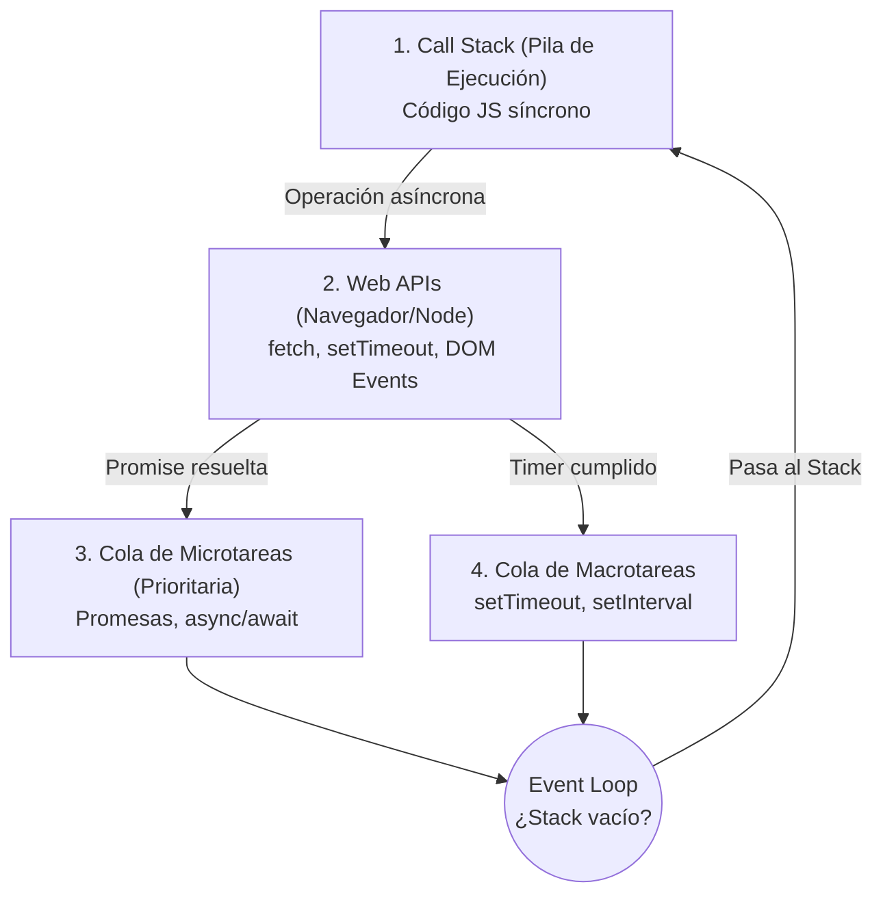

# Módulo 03: Flujo Asíncrono en JavaScript

> **Programa:** Tecnólogo en Análisis y Desarrollo de Software (ADSO)  
> **Ficha:** 3314621  
> **Competencia:** Desarrollar la solución de software de acuerdo con el diseño y metodologías de desarrollo.

---

## 🎯 Por qué la Asincronía es Vital para React

En una aplicación web real, el cliente frontend (React) necesita comunicarse con servidores backend (APIs REST en Node.js, Express, Spring Boot, FastAPI, etc.) o bases de datos externas.

JavaScript es un lenguaje de **un solo hilo de ejecución** (*single-threaded*). Si una consulta a la base de datos toma 3 segundos y se ejecutara de forma síncrona bloqueante, **la página web se congelaría por completo**: los botones no responderían, las animaciones se detendrían y el usuario experimentaría una mala experiencia.

Para evitar esto, JavaScript utiliza un modelo **asíncrono y no bloqueante** basado en el **Event Loop**.

---

## 📌 1. Anatomía del Event Loop



---

## 📌 2. De Callbacks a Promesas y `async/await`

### A. La Era Oscura: Callbacks Hell (Pirámide de la Perdición)
Antes de ES6, la asincronía se manejaba anidando funciones de respuesta:
```javascript
// ❌ CALLBACK HELL: Difícil de leer y depurar
obtenerUsuario(id, function(usuario) {
  obtenerFicha(usuario.fichaId, function(ficha) {
    obtenerCalificaciones(usuario.id, function(notas) {
      // Código inmanejable...
    });
  });
});
```

### B. La Evolución: Promesas (`Promise`)
Un objeto que representa la terminación o el fracaso eventual de una operación asíncrona.
- `pending`: Estado inicial.
- `fulfilled` (resuelta): La operación terminó con éxito (`resolve`).
- `rejected` (rechazada): La operación falló (`reject`).

```javascript
const consultarClima = () => {
  return new Promise((resolve, reject) => {
    const exito = true;
    setTimeout(() => {
      if (exito) resolve({ ciudad: "Garzón", temp: "26°C" });
      else reject(new Error("No hay conexión con la estación meteorológica"));
    }, 1000);
  });
};

consultarClima()
  .then(datos => console.log(datos))
  .catch(error => console.error(error.message));
```

### C. El Estándar Moderno: `async` / `await`
Es azúcar sintáctico (*syntactic sugar*) sobre las promesas. Permite escribir código asíncrono con la claridad y estructura del código síncrono tradicional, manejando fallos con `try...catch`.

```javascript
const obtenerDatos = async () => {
  try {
    const datos = await consultarClima();
    console.log(`Clima en ${datos.ciudad}: ${datos.temp}`);
  } catch (error) {
    console.error("Fallo al obtener clima:", error.message);
  } finally {
    console.log("Consulta finalizada.");
  }
};
```

---

## 📌 3. Consumo de APIs REST con Fetch API

`fetch()` es el método nativo del navegador (y disponible en Node.js 18+) para realizar peticiones HTTP (GET, POST, PUT, DELETE).

### Pasos Críticos al Usar `fetch()`:
1. **Petición HTTP:** `await fetch(url)` envía la solicitud.
2. **Validar Respuesta HTTP:** `if (!response.ok)` verifica códigos de error como 404 o 500.
3. **Parchear a JSON:** `await response.json()` extrae el cuerpo de la respuesta.
4. **Manejo de Errores:** Bloque `catch` para pérdidas de conexión a internet o fallos de DNS.

```javascript
const consultarAprendicesAPI = async () => {
  const URL = 'https://jsonplaceholder.typicode.com/users';

  try {
    const respuesta = await fetch(URL);

    // fetch NO rechaza la promesa en códigos 404 o 500; debemos validarlo nosotros:
    if (!respuesta.ok) {
      throw new Error(`Error en el servidor: Código ${respuesta.status}`);
    }

    const aprendices = await respuesta.json();
    return aprendices;
  } catch (error) {
    console.error("Error de Red / Conexión:", error.message);
    throw error;
  }
};
```

---

## 📌 4. Conexión con React: El Hook `useEffect`

En React, el consumo de datos asíncronos se realiza casi siempre dentro del hook `useEffect` gestionando tres estados indispensables:

```jsx
// Ejemplo en React Component:
import { useState, useEffect } from 'react';

export function ListaUsuarios() {
  const [usuarios, setUsuarios] = useState([]);
  const [cargando, setCargando] = useState(true);
  const [error, setError] = useState(null);

  useEffect(() => {
    const cargar = async () => {
      try {
        const res = await fetch('https://jsonplaceholder.typicode.com/users');
        if (!res.ok) throw new Error('Fallo al cargar usuarios');
        const data = await res.json();
        setUsuarios(data);
      } catch (err) {
        setError(err.message);
      } finally {
        setCargando(false);
      }
    };

    cargar();
  }, []); // [] significa: ejecutar una sola vez al montar el componente

  if (cargando) return <p>Cargando información del servidor...</p>;
  if (error) return <p>Ocurrió un error: {error}</p>;

  return (
    <ul>
      {usuarios.map(u => <li key={u.id}>{u.name} - {u.email}</li>)}
    </ul>
  );
}
```

---

## 💻 Práctica Recomendada
Ejecuta los ejemplos asíncronos en Node.js:
```bash
node modulos/03-flujo-asincrono/ejercicios.js
```
O pruébalo en la sección **Flujo Asíncrono** de la plataforma web `index.html`.
