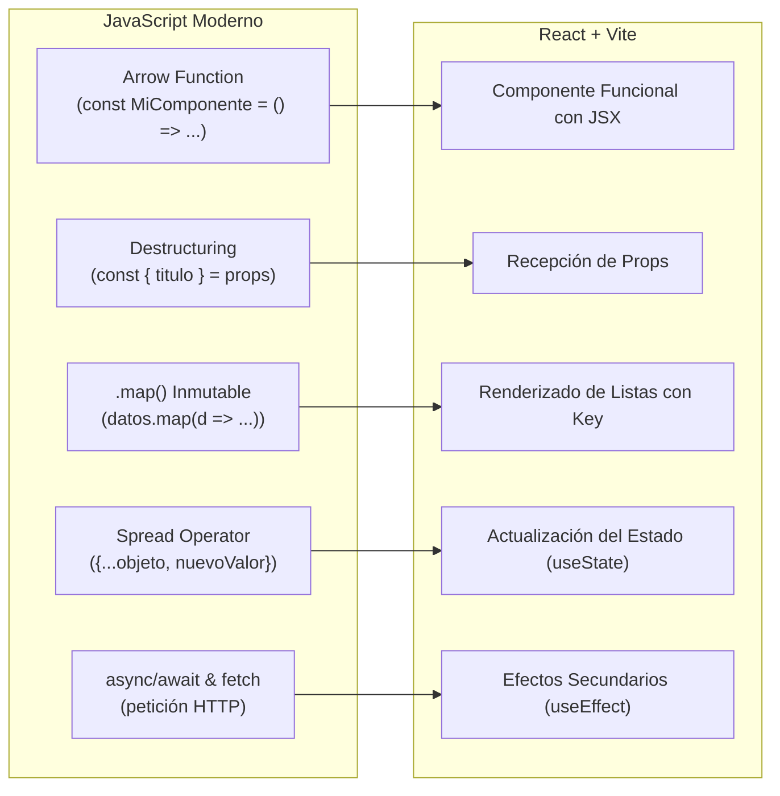

# Módulo 04: Camino a React 19 + Vite

> **Programa:** Tecnólogo en Análisis y Desarrollo de Software (ADSO)  
> **Ficha:** 3314621  
> **Competencia:** Desarrollar la solución de software de acuerdo con el diseño y metodologías de desarrollo.

---

## 🎯 Por qué React + Vite es el Ecosistema Estándar

En el mercado laboral actual, **React** es la librería de interfaces de usuario más demandada a nivel global. A diferencia de las herramientas antiguas (como `create-react-app` que usaba Webpack y tardaba minutos en compilar), **Vite** aprovecha los **ES Modules nativos** de los navegadores y el empaquetador ultrarrápido **esbuild** (escrito en Go) para ofrecer recarga en caliente (*Hot Module Replacement - HMR*) instantánea.

---

## 📌 1. El Puente Conceptual: De JavaScript a React

Todo lo que aprendiste en los 3 módulos anteriores se ensambla aquí:



---

## 📌 2. Anatomía de un Componente en React con Vite

```jsx
// src/components/TarjetaAprendiz.jsx
import React from 'react';

// 1. Arrow Function + Destructuring de Props
export const TarjetaAprendiz = ({ nombre, ficha, activo, onCambiarEstado }) => {
  return (
    // 2. JSX (HTML dentro de JavaScript con className)
    <div className={`p-4 rounded-2xl border ${activo ? 'border-emerald-500 bg-emerald-50' : 'border-slate-300'}`}>
      <h3 className="font-bold text-slate-800">{nombre}</h3>
      <p className="text-xs text-slate-500">Ficha SENA: {ficha}</p>
      
      {/* 3. Event Handler en línea con Arrow Function */}
      <button 
        onClick={() => onCambiarEstado(ficha)}
        className="mt-2 px-3 py-1 bg-[#39A900] text-white text-xs font-bold rounded-lg"
      >
        {activo ? 'Desactivar' : 'Activar'}
      </button>
    </div>
  );
};
```

---

## 📌 3. Los Dos Hooks Fundamentales

### A. `useState` (Estado Local Inmutable)
Permite que el componente recuerde información y se vuelva a renderizar cuando el estado cambia.

```jsx
import { useState } from 'react';

export function ContadorAsistencia() {
  // Destructuring de arreglo retornado por useState
  const [asistencias, setAsistencias] = useState(0);

  const registrarLlegada = () => {
    // NUNCA asistencias++ (Mutación)
    setAsistencias(asistencias + 1); // ✅ Inmutable
  };

  return (
    <div>
      <p>Aprendices presentes: {asistencias}</p>
      <button onClick={registrarLlegada}>Registrar Aprendiz</button>
    </div>
  );
}
```

### B. `useEffect` (Consumo Asíncrono de APIs y Ciclo de Vida)
Permite ejecutar código después de que el componente se monta en el navegador.

```jsx
import { useState, useEffect } from 'react';

export function CatalogoCursos() {
  const [cursos, setCursos] = useState([]);
  const [cargando, setCargando] = useState(true);

  useEffect(() => {
    // Función asíncrona dentro de useEffect
    const consultarCursos = async () => {
      try {
        const respuesta = await fetch('/api/cursos');
        const data = await respuesta.json();
        setCursos(data);
      } catch (err) {
        console.error(err);
      } finally {
        setCargando(false);
      }
    };

    consultarCursos();
  }, []); // [] = Se ejecuta una sola vez al cargar la vista

  if (cargando) return <div>Cargando catálogo...</div>;

  return (
    <div>
      {cursos.map(c => <div key={c.id}>{c.nombre}</div>)}
    </div>
  );
}
```

---

## 🚀 Siguiente Paso
Revisa la [Guía de Instalación de Vite](./guia-instalacion-vite.md) para configurar tu primer proyecto en la sala de sistemas.
